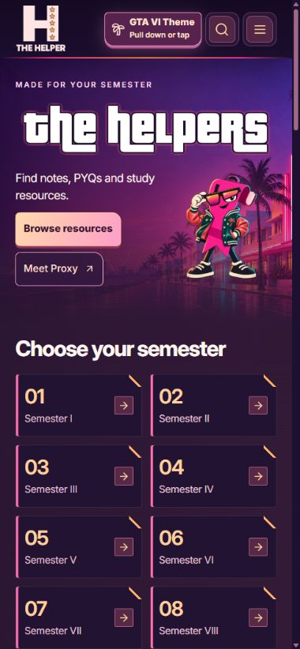
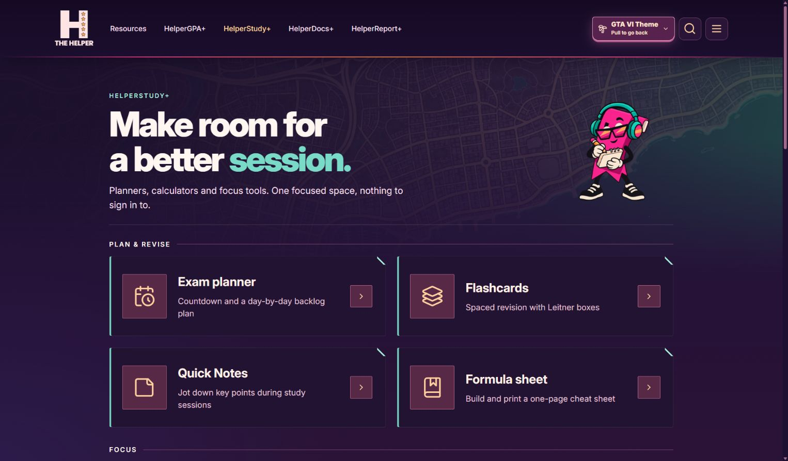

  

<h1 align="center">THE HELPER</h1>

A student-run library and study toolkit for SRMIST.

  <a href="https://www.thehelpers.tech/"><strong>Open the website ↗</strong></a> ·
  <a href="https://www.thehelpers.tech/semesters">Browse resources</a> ·
  <a href="https://www.thehelpers.tech/feedback">Share feedback</a>

## Find what you need before the next exam

THE HELPER brings notes, previous-year question papers (PYQs), syllabuses and study tools into one place. Pick a semester, find your subject and open available material in the browser. The resource library is free to browse without signing in.

| Explore | What you can do |
| --- | --- |
| [Resource library](https://www.thehelpers.tech/semesters) | Browse semesters I–VIII, search for a subject and open its available notes, PYQs and syllabus. |
| [HelperStudy+](https://www.thehelpers.tech/study-plus) | Plan exams, revise with flashcards, make formula sheets and run a focus timer. |
| [HelperGPA+](https://www.thehelpers.tech/helper-gpa) | Calculate GPA or CGPA and estimate the final-exam score needed for a target grade. |
| [HelperDocs+](https://www.thehelpers.tech/helper-docs) | Merge, split, compress or convert files using tools that run in your browser. |
| [Academia ReVanced](https://www.thehelpers.tech/academia-revanced) | Explore a student-built browser extension for the Academia dashboard. |

## Meet Proxy

Proxy is the study buddy who introduces the site. The optional **GTA VI Theme** adds a curtain intro, custom Proxy outfits and a coastal city-map backdrop across the site. Open the theme from the navigation bar to try it.

  
  

## Built by students

- [Contributors](https://www.thehelpers.tech/contributors) — meet the students who share notes and study material.
- [Initiatives](https://www.thehelpers.tech/initiatives) — explore student projects, events and hackathons.
- [Partnerships](https://www.thehelpers.tech/partnerships) — see who has helped bring those projects to campus.
- [Feedback](https://www.thehelpers.tech/feedback) — suggest a feature, report a broken link or tell us about missing material.
- [Instagram](https://www.instagram.com/thehelperinsta/) — follow project updates.

## Support the project

If THE HELPER saved you a little time, click **Star** at the top of this GitHub page or share the site with a classmate.

This public showcase contains documentation and screenshots. THE HELPER is student-run and independent of SRMIST.

[Privacy](https://www.thehelpers.tech/privacy) · [Terms](https://www.thehelpers.tech/terms) · [Copyright and content](https://www.thehelpers.tech/copyright)
