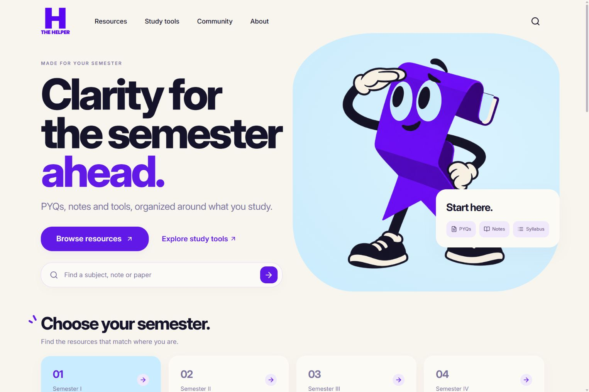

  

<h1 align="center">THE HELPER</h1>

Notes, past papers and study tools for SRMIST students.

  
  

## Hey, I’m Nabeel.

I built THE HELPER because I know what it’s like to have an exam coming up and still be hunting for the right notes. You know the subject you need. You just want to find the material and get on with studying.

So I made a place where you can pick your semester, open your subject and get to the notes, syllabus or previous-year paper you came for. I wanted it to be the kind of link you could send to a classmate and say, “Here, start with this.”

  

## If you’re here to study

- [**Browse resources**](https://www.thehelpers.tech/semesters) — find notes, previous-year question papers (PYQs) and syllabuses by subject across Semesters I–VIII. The library is free to browse without signing in.
- [**HelperStudy+**](https://www.thehelpers.tech/study-plus) — plan your exams, make flashcards or a formula sheet, or start a focus timer.
- [**HelperGPA+**](https://www.thehelpers.tech/helper-gpa) — work out your GPA, CGPA or the final-exam score you need for a target grade.
- [**HelperDocs+**](https://www.thehelpers.tech/helper-docs) — merge, split, compress or convert files in your browser.
- [**Academia ReVanced**](https://www.thehelpers.tech/academia-revanced) — explore the student-built browser extension for the Academia dashboard.

## A little hello from Proxy

I added Proxy, the purple study buddy you’ll meet on the site, because I wanted the welcome to feel like there’s a person on the other side of it. Proxy can show you around, and there’s a short note from me at the end of the tour.

## Help the next person find what they need

If a paper is missing, a link is broken or you have material that could help someone else, [tell me here](https://www.thehelpers.tech/feedback). You can also [meet the students who contribute](https://www.thehelpers.tech/contributors), see what we’ve been doing [on campus](https://www.thehelpers.tech/initiatives) or [with partners](https://www.thehelpers.tech/partnerships), and follow updates on [Instagram](https://www.instagram.com/thehelperinsta/).

If THE HELPER saved you some time, share it with a classmate or hit **Star** at the top of this GitHub page. I’m glad you’re here.

— **Nabeel Ahmad**, founder of THE HELPER

---

THE HELPER is a student-run project independent of SRMIST. This repository is the public project showcase.

[Privacy](https://www.thehelpers.tech/privacy) · [Terms](https://www.thehelpers.tech/terms) · [Copyright and content](https://www.thehelpers.tech/copyright)
