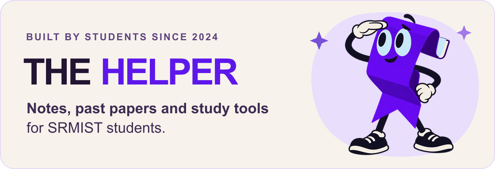

  

  
  

<a href="#hey-im-nabeel">Why I built it</a> · <a href="#how-far-it-travelled">Traction</a> · <a href="#if-youre-here-to-study">Study tools</a> · <a href="#building-beyond-the-library">Hackathons</a>

## Hey, I'm Nabeel

I built THE HELPER because I know what it’s like to have an exam coming up and still be hunting for the right notes. You know the subject you need. Somewhere there’s a useful paper or a syllabus, and you’re spending your study time working out where it is.

I launched it in **2024** with resources for **Semesters I and II**. The idea was simple enough to explain in one message to a classmate. Pick your semester, open your subject and get to the material you came for. Today you can browse all eight semesters, and students help grow the library by sharing what they’ve found. [My original launch post](https://www.linkedin.com/posts/nabeelahmad10_thehelper-academicsuccess-srmist-activity-7272681527124111360-zLMN)

## How far it travelled

During the **10–21 December exam window** that first year, **14,000+ active users across five SRM campuses** used THE HELPER. We recorded **446,000+ activity events** in those 12 days. Seeing students use it while preparing for exams made me want to keep improving it. [My December 2024 exam update](https://www.linkedin.com/posts/nabeelahmad10_exams-firstyearsuccess-academicsupport-activity-7276542700907053056-891h)

| Milestone | What we reported |
| --- | --- |
| **22,000+** | Active users at our published platform milestone |
| **4.7 million+** | Views recorded across the platform |
| **1 crore+** | Recorded interactions, including views |
| **Nearly 1 million** | Study sessions, with **900+ learners active at once** at peak |
| **15,000+** | Members across our WhatsApp groups and channel |

These are figures from our published updates. [THE HELPER initiatives and milestones](https://www.thehelpers.tech/initiatives)

## If you're here to study

- [**Browse resources**](https://www.thehelpers.tech/semesters) — find notes, previous-year question papers (PYQs) and syllabuses by subject across Semesters I–VIII. The library is free to browse without signing in.
- [**HelperStudy+**](https://www.thehelpers.tech/study-plus) — plan your exams, make flashcards or a formula sheet, or start a focus timer.
- [**HelperGPA+**](https://www.thehelpers.tech/helper-gpa) — work out your GPA, CGPA or the final-exam score you need for a target grade.
- [**HelperDocs+**](https://www.thehelpers.tech/helper-docs) — merge, split, compress or convert files in your browser.
- [**Academia ReVanced**](https://www.thehelpers.tech/academia-revanced) — explore the student-built browser extension for the Academia dashboard.

See an early version of THE HELPER

If you see a purple study buddy on the site, that’s **Proxy**. I added Proxy to welcome you and show you where to start. There’s a short note from me at the end of the tour.

## Building beyond the library

I also wanted students to have a place to try building something of their own, even if they’d never entered a hackathon. That became **Confluence**. We’ve now organised **three hackathons**. [Our event archive](https://www.thehelpers.tech/initiatives)

| Event | What we built together |
| --- | --- |
| **Confluence 1.0** · December 2025 | A **36-hour** national hackathon for first-year students. First-time teams got mentorship and a chance to ship a prototype. [Launch announcement](https://www.linkedin.com/posts/the-helper-srmist_thehelper-confluence-hackathon-activity-7410389722809729025-eA3X) |
| **Confluence 2.0** · June 2026 | **2,414 registrations** on Unstop, five tracks and an **81-hour** build. Finalists pitched their work to an industry panel. Projects ranged from financial tools to an app connecting surplus-food donors with NGOs. [Unstop listing](https://unstop.com/hackathons/confluence-20-beyond-the-edge-of-possibility-srm-insitute-of-science-and-technology-1696130) |
| **Beyond Hack 2.0** · November 2026 | A free, **eight-hour** campus hackathon across five tracks at Faraday Hall, co-organised with SRMIST’s Directorate of Alumni Affairs. [Joint announcement](https://www.instagram.com/srmist_daa/p/De9Sg5oHWzY/) |

**16 partner organisations** have supported the events, including Unstop, Logitech, HackCulture, XYZ Domains, React Kolkata and Elite Coders. They’ve helped with registration, hardware, mentorship, domains and getting opportunities in front of more students. [Meet our partners](https://www.thehelpers.tech/partnerships)

## Help the next person find what they need

If a paper is missing, a link is broken or you have material that could help someone else, [tell me here](https://www.thehelpers.tech/feedback). If you’ve already shared notes, sent the site to your class or helped run an event, thank you. That’s how this grew. [Meet the students who contribute](https://www.thehelpers.tech/contributors)

If THE HELPER saved you some time, share it with a classmate or hit **Star** at the top of this GitHub page. I’m glad you’re here.

— **Nabeel Ahmad**, founder of THE HELPER

---

THE HELPER is a student-run project independent of SRMIST. This repository is the public project showcase.

[Instagram](https://www.instagram.com/thehelperinsta/) · [LinkedIn](https://www.linkedin.com/company/the-helper-srmist/) · [WhatsApp](https://whatsapp.com/channel/0029VbDGRcmHAdNNK11YCJ3A) · [Privacy](https://www.thehelpers.tech/privacy) · [Terms](https://www.thehelpers.tech/terms) · [Copyright and content](https://www.thehelpers.tech/copyright)
